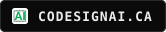
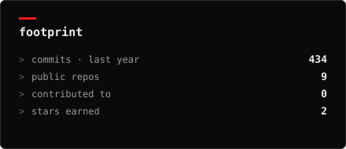
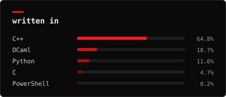

<a href="https://www.linkedin.com/in/adnaneserrai"></a>
<a href="mailto:adnaneserrai@gmail.com"></a>
<a href="https://codesignai.ca"></a>

<br/>

Final-year CS student, working on offensive and defensive security.
Last summer I built the licensing and anti-tampering layer of a commercial
analog-design tool at a Polytechnique Montréal startup. I'm still on it part-time, remotely.

Looking for a **3-month security internship, April to July 2027**. Open to anywhere.

### experience

```
2026  CoDesign AI · Polytechnique Montréal       backend & security engineering
      - anti-tampering module in C: detects in-memory patching
        (merkle-tree hashing + watchdog thread)
      - license server, FastAPI / PostgreSQL, ES256-signed JWTs
        -> sole developer, in production
      - SHA-256 verified forced updates, admin console with audit logs
      - red-team style testing of the whole protection chain

2025  Le Lobby                                    infrastructure & web
      - Active Directory + GPOs across 20 workstations
      - Laravel REST API and admin panel the owners run the place with

2024  Iwit Systems                                IT support
      - 100+ tickets closed in a newly launched monitoring team
```

### projects

**[CyberLab-2026](https://github.com/adnaneserrai/CyberLab-2026)**: a 3-VM Active Directory lab, deployed with PowerShell, then attacked end to end.
Physical access → AS-REP Roasting → LSASS dump → Pass-the-Hash → DCSync.
<sub>`Impacket` `NetExec` `Kali` `PowerShell`</sub>

**[ebpf-xdp-ips](https://github.com/adnaneserrai/ebpf-xdp-ips)**: drops Nmap stealth scans at the driver level, before iptables ever sees them, with live telemetry.
<sub>`C` `eBPF` `XDP` `Python/BCC`</sub>

**[cooja-rpl-blackhole](https://github.com/adnaneserrai/cooja-rpl-blackhole)**: a forged-rank node that hijacks a 6LoWPAN mesh. About 60% packet loss measured.
<sub>`C` `Contiki-NG` `Cooja` `Wireshark`</sub>

**[dead-space-3-linear-mouse-fix](https://github.com/adnaneserrai/dead-space-3-linear-mouse-fix)**: ASI plugin hooking DirectInput to kill Dead Space 3's negative mouse acceleration, in both hip-fire and ADS.
<sub>`C++` `DirectInput` `x64dbg`</sub>

**[codesignai.ca](https://codesignai.ca)**: designed, built and deployed the startup's website. I still maintain it as a freelancer.

**homelab**: self-hosting, networking and security. It keeps changing.

<details>
<summary>older / school</summary>

- [Logo-Interpreter-OCaml](https://github.com/adnaneserrai/Logo-Interpreter-OCaml): lexer, parser and interpreter for Logo (ocamllex / ocamlyacc)
- [Tower-Defend-C](https://github.com/adnaneserrai/Tower-Defend-C): procedural tower defense in C and SDL2

</details>

### toolbox

| | |
|---|---|
| offensive | Active Directory, Kerberos, Impacket, NetExec, Nmap, Burp Suite, Kali |
| defense & RE | eBPF/XDP, Wireshark, x86 reverse engineering, x64dbg |
| systems | Linux, Windows Server, GPO, Docker, VMware, Git |
| languages | C, C++, Python, PowerShell, SQL, PHP, JavaScript, OCaml |
| frameworks | FastAPI, Laravel, Symfony, PostgreSQL |
| practice | Root-Me (top 1000), TryHackMe, Hack The Box |

### activity

<div align="center">





</div>

### else

B.Sc. Computer Science, Université de Poitiers (2024–2027).
French, English C1, Spanish B1. Off the keyboard: BJJ, wrestling, climbing, guitar, piano.


